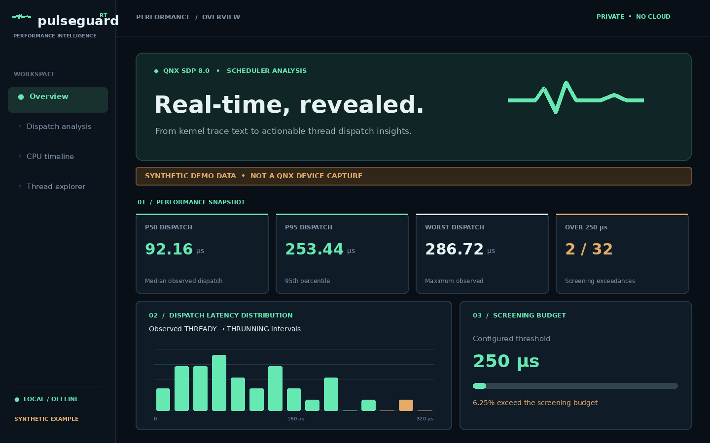

# PulseGuard RT



*Illustrative dashboard preview based on the bundled **synthetic QNX-format trace**. This is not a measured QNX device capture.*

**See what the scheduler is telling you.** An offline, zero-dependency performance intelligence tool for **QNX SDP 8.0** developers, written by Samer Tallauze for the QNX Global Hackathon (November–December 2026).

**[Run the 60-second demo](#start-in-under-one-minute--no-qnx-sdk-needed-for-demo)** · **[Explore the capabilities](#capabilities)** · **[Follow the QNX codelab](docs/CODELAB.md)** · **[Watch the demo](https://www.youtube.com/watch?v=HXBaztZVK-s)**

**Category:** Developer Tooling & Host Tools · **License:** MIT · **Host:** Linux / macOS / Windows, Python 3.10+ · **Target analyzed:** QNX OS 8.0 (QEMU, Raspberry Pi 5, or supported hardware)

PulseGuard turns the documented, textual output of QNX's `traceprinter` into an interactive local report about **thread dispatch delay** and **mutex-wait candidates**. It works even without target access once a trace text file is exported. It does not depend on cloud services, third-party telemetry, external Python dependencies, or proprietary parsers.

## Why this exists

In an embedded real-time system, a task can be ready to run but wait for a CPU. When that delay grows, an application may have less headroom to meet its own response-time objectives. Raw kernel event streams are accurate but cumbersome to inspect. PulseGuard reduces the time between *capturing scheduling evidence* and *finding which threads deserve investigation*.

### Capabilities

| Feature | What it actually does |
| --- | --- |
| QNX trace ingestion | Reads QNX 8.0 `traceprinter` text (`t:0x... CPU:... THREAD:...`), cycle frequency, CPU metadata, and thread IDs |
| Dispatch latency | Pairs `THREADY` and `THRUNNING`, reports p50/p95/p99/max and per-thread breakdown |
| Mutex blocking signals | Pairs `THMUTEX` with the next `THREADY` for the same thread, without asserting priority inversion |
| CPU execution timeline | Visualizes observed thread-running spans without inventing CPU-idle time |
| Interactive thresholds | Explore samples exceeding a configurable dispatch-latency screening budget |
| Performance regression gate | Compare two JSON reports by p95, optionally fail CI if regression exceeds a percentage |
| Portable offline dashboard | Self-contained HTML (no JavaScript libraries, CDN, API requests, or tracking) |
| JSON / CLI exports | Scriptable machine-readable output and exit codes (`0` pass, `1` error, `2` threshold failure) |

> **Important:** A scheduler dispatch threshold breach is **not** necessarily an application deadline miss. Mutex waiting alone does **not** prove priority inversion. This is a diagnostic aid, **not** a medical, automotive safety, or functional-safety certification tool.

## Start in under one minute — no QNX SDK needed for demo

```bash
git clone https://github.com/samertall/pulseguard-rt.git
cd pulseguard-rt
python3 -m pulseguard demo --output-dir demo-output
```

Open `demo-output/report.html` in any modern browser. The synthetic demo contains 67 QNX-format kernel events, two logical CPUs, and 32 ready-to-running dispatches; it is explicitly marked **SYNTHETIC DATA** and does *not* represent an actual QNX device capture.

Run the example directly:

```bash
python3 -m pulseguard analyze examples/synthetic_qnx8_trace.txt \
  --budget-us 250 --json demo-output/report.json --html demo-output/report.html
python3 -m unittest discover -s tests -v
```

Optional installation, if using standard Python packaging:

```bash
python3 -m pip install -e .
pulseguard --help
```

## Real QNX 8.0 capture → host analysis

**QNX-specific evidence:** `pulseguard/parser.py` recognizes the `TRACE_CYCLES_PER_SEC` header and native `t:0x... CPU:... THREAD:THREADY/THRUNNING/THMUTEX pid:X tid:Y` event syntax produced by QNX SDP 8.0 `traceprinter`. `pulseguard/analysis.py` reconstructs QNX kernel thread-state transitions. These are not generic Linux `perf` or POSIX log events.

1. Install **QNX SDP 8.0** using [QNX Everywhere](https://qnx.software/en/developers/get-started/qnx-everywhere) and follow the [SDP 8.0 quick start](https://www.qnx.com/developers/docs/8.0/com.qnx.doc.qnxsdp.quickstart/topic/about.html) to boot a supported QNX 8.0 target or QEMU VM.
2. On that **QNX target**, as root, record a short capture while your workload is active (requires the instrumented `procnto`, provided with QNX 8.0):

   ```sh
   tracelogger -s 10 -w -f /dev/shmem/pulseguard.kev
   ```

3. On **QNX or an SDP-equipped host** (Windows/Linux), format the proprietary `.kev` using QNX's `traceprinter` utility:

   ```sh
   traceprinter -f /path/to/pulseguard.kev -o pulseguard.txt
   ```

4. Copy `pulseguard.txt` to your ordinary Linux/macOS/Windows computer and analyze:

   ```bash
   python3 -m pulseguard analyze pulseguard.txt \
     --budget-us 250 \
     --json output/report.json \
     --html output/report.html
   ```

5. Open the HTML. Use its threshold explorer, thread table, slowest dispatch list, and source-line references to inspect the capture. For an automated check:

   ```bash
   python3 -m pulseguard analyze pulseguard.txt --budget-us 250 --strict
   python3 -m pulseguard compare output/baseline.json output/report.json \
     --max-p95-regression-pct 10
   ```

   `--strict` exits 2 if any **observed dispatch** exceeds the configured threshold. `compare` exits 2 if the candidate's p95 exceeds the allowed relative regression. Neither claims to certify real-time deadlines.

The capture commands above use the exact `-s`, `-w`, `-f`, and `-o` options documented for QNX SDP 8.0; capture on QNX requires appropriate privileges and target access.

### Supported input and interpretation

- Only **text** output from `traceprinter`, not raw `.kev` binary input. The default QNX output layout and wrapped `pid`/`tid` continuation lines are understood. Custom `traceprinter -p` layouts may be incompatible.
- Converts CPU clock cycles to elapsed microseconds using `TRACE_CYCLES_PER_SEC`; if missing, provide `--frequency` in cycles/sec. Output header declares QNX release when available.
- Dispatch latency is a complete `THREADY` → `THRUNNING` pair for the same `(PID,TID)`; blocking events cancel stale pending ready-state observations. Incomplete intervals are excluded; temporal precision depends on the trace.
- Mutex duration is `THMUTEX` → `THREADY`, which may be influenced by tracing and scheduling. It does not establish who owned a mutex.
- One sample begins when a thread becomes ready and ends when it first runs; other event types are not used to fabricate a sample.
- Timeline spans are conservative visualizations between observed state changes, truncated at known transitions rather than claiming total CPU utilization.
- Reports may contain warnings for low sample counts, out-of-order timestamps, missing trace metadata, or truncated interactive sample counts.
- All JSON aggregate metrics cover the full in-memory capture. HTML interaction is limited to 50,000 dispatches for responsiveness; this restriction is flagged in warnings when reached.

### Requirements and reproducibility

| Component | Version / target | Toolchain |
| --- | --- | --- |
| Capture system | QNX OS / QNX SDP **8.0** on QEMU, Raspberry Pi 5, or other supported hardware | QNX native `tracelogger`, instrumented `procnto` |
| Event formatter | QNX SDP **8.0** tool (on QNX or host) | QNX `traceprinter` |
| PulseGuard host | Linux, macOS, Windows | CPython **3.10+**, standard library only |
| Demo target | Linux host with Python 3.10+ | No QNX license/hardware needed for synthetic fixture |

**Testing status:** parser, analysis, CLI, and HTML-generation unit tests run on the Linux host. Actual QNX 8.0 capture should be validated by a participant with an installed QNX Everywhere environment before claiming real target testing. The included synthetic fixture is suitable for reproducible host-tool demonstration only.

## Architecture

```text
QNX 8.0 target / QEMU
   tracelogger → .kev
   traceprinter → text
                    ↓
      parser.py (QNX headers & thread events)
                    ↓
      analysis.py (latencies, waits, warnings)
                    ↓
       ┌────────────┴────────────┐
   CLI / JSON              Offline HTML
   CI comparison           interactive report
```

## Tutorial / codelab

Read [the guided QNX 8.0 tracing codelab](docs/CODELAB.md) for a step-by-step capture-to-diagnosis workflow, interpretation questions, and expected outcomes. It is free and included in this repository.

## Official references

- [QNX SDP 8.0 traceprinter utility](https://qnx.com/developers/docs/8.0/com.qnx.doc.neutrino.utilities/topic/t/traceprinter.html)
- [QNX SDP 8.0 tracelogger utility](https://www.qnx.com/developers/docs/8.0/com.qnx.doc.neutrino.utilities/topic/t/tracelogger.html)
- [QNX System Analysis Toolkit: reading traceprinter output](https://qnx.com/developers/docs/8.0/com.qnx.doc.sat/topic/datainterpretation_Using_traceprinter.html)
- [QNX Global Hackathon rules](https://qnx.devpost.com/rules)

## Project status / roadmap

**Implemented now:** trace parsing, latency/contended-wait analysis, test suite, offline interactive dashboard, JSON export, CLI threshold check, p95 regression comparison, and reproducible synthetic example.

**Future opportunities (not claimed as delivered):** live target capture and deployment helper, richer message-passing correlation, trace loss detection, priority inversion correlation using thread priorities, large-file streaming, and actual QNX 8.0 target verification.

## Attribution and licensing

Original implementation and user interface © 2026 Samer Tallauze · [samertall.com](https://samertall.com) · [MIT License](LICENSE). No QNX proprietary SDK files are redistributed. QNX documentation and products belong to their respective owners; QNX is used descriptively to identify the target platform.
